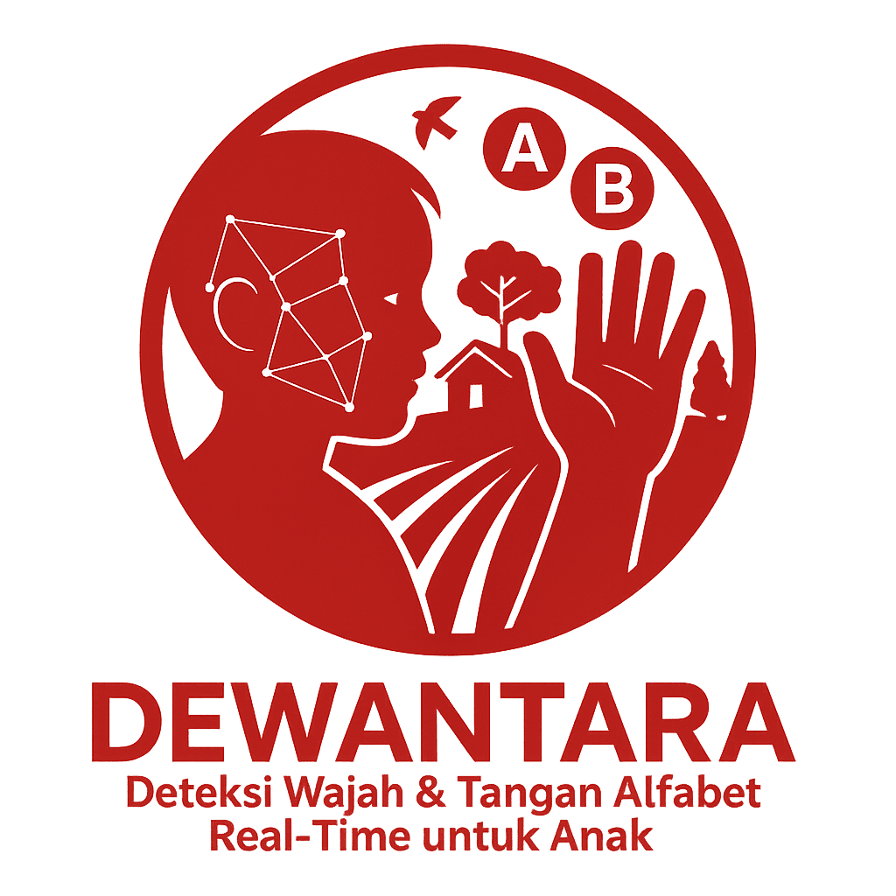
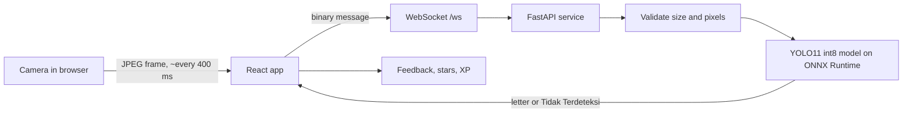

<div align="center">



# DEWANTARA

**Real-time BISINDO alphabet detection for deaf children in areas far from special schools.**

[](LICENSE)
[](#recognition-and-funding)
[](https://sdgs.un.org/goals/goal4)
[](https://sdgs.un.org/goals/goal10)

</div>

---

<div align="center">

## Overview

DEWANTARA is a web application that teaches the Indonesian Sign Language (BISINDO) alphabet through a phone or laptop camera.
A child forms a letter with one hand. The app reads the sign, shows the matching letter, and gives feedback right away.

Many villages in Indonesia have no Sekolah Luar Biasa (SLB, special school) and no BISINDO teacher.
Parents and volunteers there often do not know the language either.
DEWANTARA gives these families and community teachers a learning tool that runs in a browser, with no app to install and no specialist on site.

### Tech stack


</div>

---

## Table of contents

- [Recognition and funding](#recognition-and-funding)
- [Features](#features)
- [Tech stack](#tech-stack-1)
- [How it works](#how-it-works)
- [Project structure](#project-structure)
- [Getting started](#getting-started)
- [Configuration](#configuration)
- [API reference](#api-reference)
- [Deployment notes](#deployment-notes)
- [Team](#team)
- [License](#license)

## Recognition and funding

DEWANTARA received funding from the **Innovillage 2025** social project program, organized by **Telkom Indonesia** and **Danantara Indonesia**.
The project placed in the **TOP 50** of the program.

The project targets deaf children in the community of a partner foundation in Majalengka Regency, West Java. It supports two UN Sustainable Development Goals: SDG 4 (Quality Education) and SDG 10 (Reduced Inequalities).

## Features

| Area | What it does |
| --- | --- |
| Real-time detection | Reads the 26 BISINDO letters (A to Z) from a live camera feed. |
| Adventure mode | Five levels (A-E, F-J, K-O, P-T, U-Z) on a map. Learners earn stars and XP, and later levels unlock as stars add up. |
| Free practice | An open camera page for signing any letter without level rules. |
| Dictionary | Reference images for the 26 letters and the numbers 1 to 10, plus 15 vocabulary videos (for example "aku", "kamu", "apa"). |
| Progress tracking | XP, daily streak, stars, best time, and attempts, stored in the browser's `localStorage`. No account needed. |
| Low-bandwidth design | The browser sends one small JPEG frame about every 400 ms (roughly 2.5 frames per second). |
| Safe public API | Origin allow-list, frame size and pixel limits, bounded concurrency, and idle timeouts. |

## Tech stack

| Layer | Technology | Role |
| --- | --- | --- |
| Frontend | React 18.3 | User interface and lesson logic. |
| Frontend | React Router 6 | Page routing (home, learn, free practice, dictionary, about, contact). |
| Frontend | Create React App 5 | Build tooling and dev server. |
| Frontend | SweetAlert2 11 | Dialogs and alerts. |
| Frontend | Browser WebSocket and Canvas APIs | Capture camera frames and stream them to the AI service. |
| AI service | Python 3.11+ | Runtime. |
| AI service | FastAPI and Uvicorn | HTTP endpoints and the WebSocket server (ASGI). |
| AI service | ONNX Runtime | CPU inference for the detection model. |
| AI service | YOLO11 (int8 ONNX) | Letter detection model, 480 x 480 input. |
| AI service | OpenCV and NumPy | Frame decoding, resizing, and post-processing. |

## How it works



1. The browser opens the camera and draws a frame onto a canvas.
2. The frame goes to the AI service as a JPEG over a WebSocket connection.
3. The service checks the frame size, decodes it, resizes it to 480 x 480, and runs the model on CPU.
4. A detector built on YOLO11 returns the most confident letter above the confidence threshold. If nothing passes, the service answers `Tidak Terdeteksi` ("not detected").
5. The app compares the answer with the target letter and updates the lesson.

The detection model is a YOLO11 object detector, converted to an int8 ONNX graph at 480 x 480 input. It runs on CPU, so the service needs no GPU.

## Project structure

```text
dewantara/
├── ai-service/                  # FastAPI inference service
│   ├── app/
│   │   ├── main.py              # HTTP and WebSocket endpoints
│   │   ├── detector.py          # ONNX inference, NMS, image-size checks
│   │   └── config.py            # Environment-based settings
│   ├── models/
│   │   └── bisindo_yolo11_int8.onnx   # ~31 MB model
│   └── requirements.txt
├── application/                 # React frontend (Create React App)
│   ├── public/                  # Letter images, number images, vocabulary videos
│   └── src/
│       ├── components/          # Navbar, Footer, VideoDisplay, gamification UI
│       ├── context/             # GameContext (progress), CameraContext
│       ├── data/                # Levels and dictionary data
│       ├── pages/               # Home, Learn, Free detect, Dictionary, About, Contact
│       └── config.js            # API and WebSocket endpoints
├── LICENSE
└── README.md
```

## Getting started

### Prerequisites

- Node.js 18 or newer, with npm
- Python 3.11 or newer
- A device with a camera. Browsers only allow camera access on `localhost` or over HTTPS.

### 1. Clone the repository

```bash
git clone https://github.com/wildannzm/dewantara.git
cd dewantara
```

### 2. Start the AI service

```bash
cd ai-service
python -m venv .venv
source .venv/bin/activate        # Windows: .venv\Scripts\activate
pip install -r requirements.txt
uvicorn app.main:app --host 0.0.0.0 --port 8000
```

Check that it is running:

```bash
curl http://localhost:8000/health
# {"status":"ok"}
```

Run the `uvicorn` command from inside `ai-service/`, because the app imports from the `app` package by name.

### 3. Start the frontend

In a second terminal:

```bash
cd application
npm install
npm start
```

Open <http://localhost:3000>. On `localhost` the frontend talks to `http://localhost:8000` by default.

### 4. Build for production

```bash
cd application
npm run build
```

The static files land in `application/build/`.

## Configuration

### AI service

The service reads these environment variables at startup. It refuses to start if a value is invalid.

| Variable | Default | Description |
| --- | --- | --- |
| `MODEL_PATH` | `models/bisindo_yolo11_int8.onnx` | Path to the ONNX model. |
| `INPUT_SIZE` | `480` | Model input size. Must be a positive multiple of 32. |
| `CONFIDENCE_THRESHOLD` | `0.40` | Minimum class score, between 0 and 1 (exclusive). |
| `IOU_THRESHOLD` | `0.45` | Overlap threshold for non-max suppression. |
| `MAX_FRAME_BYTES` | `4194304` | Largest accepted frame in bytes (4 MiB). |
| `MAX_IMAGE_PIXELS` | `8000000` | Largest accepted frame in pixels. |
| `MAX_CONCURRENT_INFERENCES` | `1` | Number of frames processed at the same time. |
| `IDLE_TIMEOUT_SECONDS` | `120` | Seconds of silence before the server closes a session. |
| `ALLOWED_ORIGINS` | localhost:3000 | Comma-separated browser origins. `*` turns the check off. |
| `LOG_LEVEL` | `INFO` | Python logging level. |

Example:

```bash
CONFIDENCE_THRESHOLD=0.5 ALLOWED_ORIGINS=https://example.org uvicorn app.main:app --port 8000
```

### Frontend

Create React App reads these variables at build time.

| Variable | Default | Description |
| --- | --- | --- |
| `REACT_APP_API_BASE_URL` | `http://localhost:8000` on localhost | Base URL of the AI service. |
| `REACT_APP_WS_URL` | Derived from the base URL, for example `ws://localhost:8000/ws` | Full WebSocket URL. |

Put local overrides in `application/.env.local`, which Git ignores.

## API reference

The service has no authentication. It protects itself with the limits listed under [Configuration](#configuration).

| Method | Path | Response |
| --- | --- | --- |
| `GET` | `/` | `{"message": "Dewantara AI Server Ready", "status": "active"}` |
| `GET` | `/health` | `{"status": "ok"}` |
| `WS` | `/ws` | Detection session, described below. |

### WebSocket protocol

1. The client connects to `/ws`. Browsers must send an allowed `Origin`, otherwise the server closes the connection with code `1008`.
2. The server sends `{"status": "connected", "message": "Welcome"}`.
3. The client sends one JPEG or PNG frame as a binary message.
4. The server replies with one text message: a single letter from `A` to `Z`, or `Tidak Terdeteksi` when no sign is found.
5. Steps 3 and 4 repeat until either side closes the connection.

Text messages from the client close the session with code `1003`. Frames over `MAX_FRAME_BYTES` get `Tidak Terdeteksi` without inference.

Minimal Python client:

```python
import asyncio, websockets

async def main():
    async with websockets.connect("ws://localhost:8000/ws") as ws:
        print(await ws.recv())                     # welcome message
        with open("frame.jpg", "rb") as f:
            await ws.send(f.read())
        print(await ws.recv())                     # e.g. "A" or "Tidak Terdeteksi"

asyncio.run(main())
```

## Deployment notes

- Serve the frontend over HTTPS, since browsers block camera access on plain HTTP.
- Serve the AI service over TLS too. A page loaded from HTTPS cannot open an unencrypted `ws://` connection.
- If a reverse proxy sits in front of Uvicorn, enable WebSocket upgrades and set a read timeout longer than `IDLE_TIMEOUT_SECONDS`.
- Add your frontend origin to `ALLOWED_ORIGINS`.
- Inference is CPU-bound. Raise `MAX_CONCURRENT_INFERENCES` only after you have measured CPU headroom, or run more worker processes.
- The model file is about 31 MB and is stored in the repository.

## Team

| Name | Role |
| --- | --- |
| Abrar Wahid | Leader and AI Engineer |
| Wildan Zhilal Manafi | Full Stack Engineer |
| Ibnu Restu Pamungkas | Documentarian |

## License

Released under the [MIT License](LICENSE). Copyright (c) 2026 WindTech.

The detection model comes from a third party. Check its model card for the license terms that apply to the weights.

## Acknowledgments

- [Innovillage](https://innovillage.id), organized by Telkom Indonesia and Danantara Indonesia, for funding and support.
- The partner foundation and community in Majalengka, West Java, for guidance and field validation.
- [Ultralytics YOLO11](https://github.com/ultralytics/ultralytics), [ONNX Runtime](https://onnxruntime.ai), [FastAPI](https://fastapi.tiangolo.com), and [React](https://react.dev).
